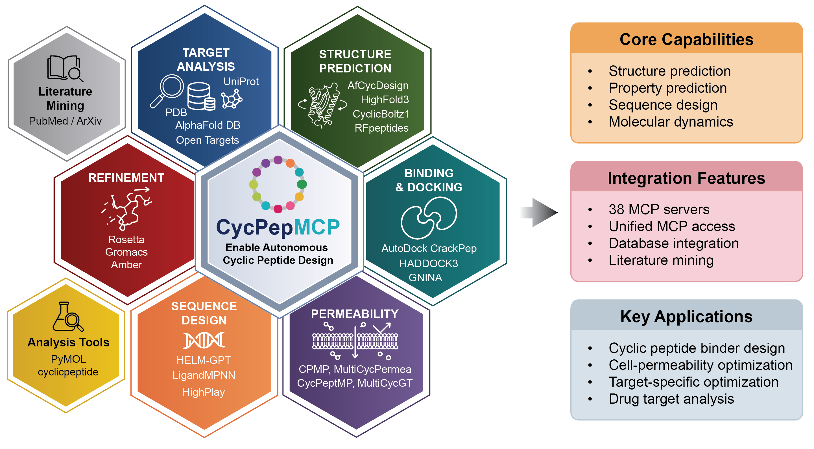

# CycPepMCP: Democratizing Cyclic Peptide Design with Agentic AI
[](./LICENSE)
Cyclic peptide engineering toolkit for [Claude Code](https://claude.ai/code) via the Model Context Protocol (MCP). 26 MCP servers covering backbone generation, sequence design, structure prediction, MD simulation, and property optimization.



## Prerequisites

- [Claude Code](https://docs.anthropic.com/en/docs/claude-code) CLI installed
- Python 3.10+ with [conda/mamba](https://github.com/conda-forge/miniforge)
- [uv](https://docs.astral.sh/uv/) (for lightweight MCPs)
- [Docker](https://docs.docker.com/get-docker/) with NVIDIA GPU support (for GPU MCPs)

## Install CycPepMCP

```bash
git clone https://github.com/macronex/CycPepMCP.git
cd CycPepMCP

mamba env create -f environment.yml -y
mamba activate cycpepmcp
pip install -r requirements.txt
pip install -e .
```

## Install MCP Servers

Each MCP uses one of three runtimes: **uv** (fast, lightweight), **docker** (GPU/complex deps, local build preferred), or **python** (conda).

```bash
# See all available MCPs and their runtimes
cpmcp avail

# Install any MCP (auto-detects runtime)
cpmcp install <mcp_name>

# Check what's installed
cpmcp status
```

### UV MCPs (lightweight, no GPU)

Fastest to install. `cpmcp install` creates a `uv` virtualenv and installs pip dependencies automatically.

```bash
# Example: install a lightweight MCP
cpmcp install cyclicchamp_mcp
```

| MCP | Description |
|-----|-------------|
| `cyclicchamp_mcp` | Heuristic energy-based cyclic peptide design |
| `haddock3_mcp` | HADDOCK3 integrative modeling for docking |
| `highplay_mcp` | RL-based cyclic peptide sequence design (MCTS) |
| `multicycgt_mcp` | GCN+Transformer membrane permeability prediction |
| `multicycpermea_mcp` | Multimodal permeability prediction (images + SMILES) |
| `pepflow_mcp` | Performance estimation optimization workflow |
| `pharmpapp_mcp` | Permeability prediction (Caco-2, RRCK, PAMPA) |

### Docker MCPs (GPU, complex dependencies)

For GPU-accelerated tools. **Local builds are preferred** over pulling from GHCR — they're faster and let you customize.

```bash
# Build locally (preferred)
cd tool-mcps/afcycdesign_mcp
docker build -t afcycdesign_mcp:latest .
cd ../..

# Then install — auto-detects the local image
cpmcp install afcycdesign_mcp

# Or pull from GHCR (fallback, if no local image)
cpmcp install rfpeptides_mcp
```

To build all Docker MCPs locally:

```bash
for mcp_dir in tool-mcps/*/; do
  if [ -f "$mcp_dir/Dockerfile" ]; then
    name=$(basename "$mcp_dir")
    echo "Building $name..."
    docker build -t "${name}:latest" "$mcp_dir"
  fi
done
```

| MCP | Description |
|-----|-------------|
| `rfpeptides_mcp` | RFDiffusion All-Atom for cyclic peptide backbone generation |
| `proteinmpnn_mcp` | ProteinMPNN inverse folding sequence design |
| `afcycdesign_mcp` | AlphaFold-based cyclic peptide design & validation |
| `rosetta_kic_mcp` | Rosetta KIC/GenKIC for cyclic peptide modeling |
| `helmgpt_mcp` | GPT-based de novo macrocyclic peptide design (HELM) |
| `boltz_mcp` | Boltz2 structure & affinity prediction |
| `boltzgen_mcp` | BoltzGen protein binder design |
| `highfold_med_mcp` | Fine-tuned AlphaFold for cyclic peptides |
| `highfold3_mcp` | AlphaFold3 with CycPOEM & Cyclization Switch |
| `alphafold3_mcp` | AlphaFold3 biomolecular structure prediction |
| `ligandmpnn_mcp` | LigandMPNN structure-aware sequence design |
| `cpmp_mcp` | MAT deep learning membrane permeability prediction |
| `gromacs_mcp` | GROMACS molecular dynamics simulations |
| `amber_mcp` | Amber MD simulations & free energy calculations |

### Conda MCPs (legacy)

These require conda environments (run `quick_setup.sh` in each MCP directory):

| MCP | Description |
|-----|-------------|
| `ADCP_mcp` | AutoDock CrankPep conformational sampling |
| `cyc_builder_mcp` | MCTS + fragment assembly cyclic peptide design |
| `cyclicpeptide_mcp` | Cyclic peptide drug design & virtual screening |
| `cycpeptmp_mcp` | Multi-level feature permeability prediction |
| `pepflowww_mcp` | Full-atom peptide design via flow matching (ICML 2024) |

## Workflow Skills

Multi-step protocols that orchestrate multiple MCPs into complete design pipelines.

```bash
# List available workflows
cpskill avail

# Install a workflow (also installs required MCPs)
cpskill install binder_design_rfpeptides

# Run step-by-step
cpskill execute binder_design_rfpeptides
```

### Binder Design Workflow (RFpeptides)

The primary 5-stage pipeline for designing cyclic peptide binders:

1. **Backbone Generation** — RFpeptides generates cyclic peptide backbones against a target protein
2. **Sequence Design** — 4 rounds of ProteinMPNN (CA-only) + Rosetta FastRelax
3. **DL Validation** — AfCycDesign reprediction (iPAE, RMSD, pLDDT)
4. **Physics Filtering** — Rosetta interface metrics (ddG, SAP, CMS)
5. **Clustering & Selection** — RMSD-based clustering, ranked by composite score

Quality thresholds:

| Metric | Threshold | Meaning |
|--------|-----------|---------|
| ddG | < -30 REU | Binding energy |
| SAP | < 35 | Aggregation propensity |
| CMS | > 300 A^2 | Contact surface area |
| iPAE | < 0.20 | Interface confidence |
| RMSD | < 1.5 A | Reprediction fidelity |
| pLDDT | > 0.70 | Per-residue confidence |

## CLI Reference

### cpmcp (MCP management)

```bash
cpmcp avail                    # List all MCPs with runtime info
cpmcp status                   # Show installed/registered status
cpmcp status --refresh         # Refresh status cache
cpmcp install <name>           # Install + register with Claude Code
cpmcp install <name> --no-register  # Install only
cpmcp uninstall <name>         # Unregister from Claude Code
cpmcp info <name>              # Show MCP details
cpmcp search <query>           # Search by name/description
cpmcp sync                     # Sync registry with filesystem
```

### cpskill (workflow management)

```bash
cpskill avail                  # List available workflows
cpskill install <name>         # Install workflow + required MCPs
cpskill execute <name>         # Run workflow step-by-step
cpskill uninstall <name>       # Remove workflow
```

## Example: MDM2 Binder Design

```bash
# Install the three core MCPs
cpmcp install rfpeptides_mcp
cpmcp install proteinmpnn_mcp
cpmcp install afcycdesign_mcp

# Target PDB is included
ls examples/case1_cycpep_design/4HFZ_MDM2.pdb

# Use Claude Code to run the workflow
# MDM2 hotspot residues: 54, 56, 58, 61, 67, 96, 99, 100
```

## Architecture

```
CycPepMCP/
├── src/
│   ├── mcp_cli.py              # cpmcp CLI
│   ├── skill_cli.py            # cpskill CLI
│   ├── cycpep_mcp/             # MCP management (registry, install, status)
│   └── skill/                  # Workflow skill management
├── tool-mcps/                  # 26 MCP server implementations
│   └── <mcp_name>/
│       ├── src/server.py       # FastMCP server
│       ├── requirements.txt    # Python dependencies
│       ├── Dockerfile          # (docker MCPs only)
│       └── quick_setup.sh      # Setup script
├── workflow-skills/            # Multi-step workflow definitions (.md)
├── examples/                   # Example data (PDBs, sequences)
└── details.md                  # Extended feature documentation
```

See [details.md](details.md) for extended documentation.

## License
This code is licensed under [](./LICENSE).

